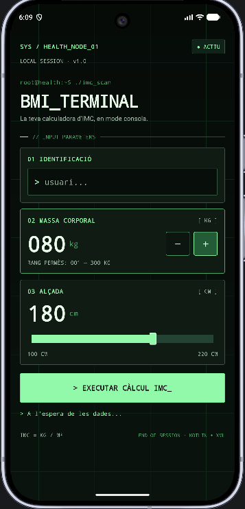
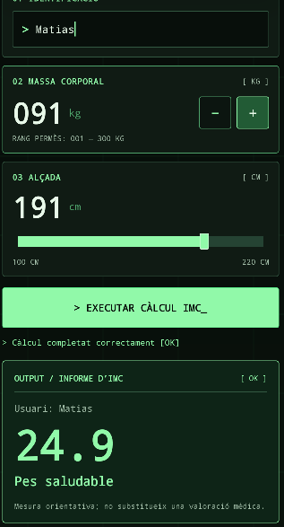

# BMI_TERMINAL — Calculadora d'IMC

Aplicació Android creada amb **Kotlin i XML** per calcular l'**índex de massa corporal (IMC)**. En aquesta versió, la calculadora té una identitat visual pròpia inspirada en una **terminal informàtica**: fons negre amb quadrícula subtil, tipografia monoespaiada, verd fòsfor i ordres de consola.

> **Aquesta app no utilitza Jetpack Compose.** El títol de l'enunciat el menciona, però els objectius detallats indiquen explícitament que s'ha de construir una UI amb **XML**, que és el sistema utilitzat en aquest projecte.

## Interfície

| Formulari | Informe de l'IMC |
|  |  |

**Avís per a l'entrega:** aquestes imatges són **previsualitzacions (maquetes)** del disseny, **no captures de pantalla reals**. Abans de lliurar el treball, cal executar-lo en un emulador o dispositiu Android, fer dues captures reals i substituir `docs/imatges/vista-inicial.png` i `docs/imatges/vista-resultat.png` pels fitxers capturats.

## Què permet fer?

- **Introduir el nom** de la persona, amb validació per evitar calcular si el camp està buit.
- **Modificar el pes** amb els botons `−` i `+` entre **1 i 300 kg**.
- **Seleccionar l'alçada** amb una barra lliscant entre **100 i 220 cm**.
- **Calcular l'IMC** mitjançant el botó `> EXECUTAR CÀLCUL IMC_`.
- **Mostrar l'informe** amb el nom, el valor d'IMC i la seva classificació.
- **Actualitzar la línia d'estat** amb missatges de consola segons les accions.
- **Ocultar el resultat anterior** quan es modifica qualsevol entrada.
- **Conservar les dades** en girar la pantalla, mitjançant `onSaveInstanceState`.

### Exemple

Amb un pes de **80 kg** i una alçada de **180 cm**:

```text
> Usuari: Matias
> Pes: 80 kg
> Alçada: 180 cm
> IMC = 80 / (1,80 × 1,80)
> IMC = 24,7
> Categoria: Pes saludable
```

| IMC | Categoria |
|:--|:--|
| Inferior a 18,5 | Pes baix |
| 18,5 a menys de 25 | Pes saludable |
| 25 a menys de 30 | Sobrepès |
| 30 o superior | Obesitat |

L'IMC és una dada orientativa i **no és un diagnòstic mèdic**.

## Tecnologies i components

- **Kotlin:** lògica, esdeveniments, validació i càlcul.
- **XML:** elements de la UI, distribució i aparença.
- **Android Studio + Gradle:** entorn i construcció de l'app.
- **AndroidX / AppCompat:** compatibilitat i comportament dels controls.
- **JUnit:** proves unitàries de les categories i el càlcul de l'IMC.

La interfície XML fa servir `ScrollView`, `LinearLayout`, `TextView`, `EditText`, `SeekBar` i `AppCompatButton`. El codi Kotlin hi accedeix amb `findViewById`, detecta els clics amb `setOnClickListener` i els canvis d'alçada amb `setOnSeekBarChangeListener`.

## Estructura

```text
BMICalculator/
├── app/
│   └── src/
│       ├── main/
│       │   ├── java/org/matiasvilella/bmicalculator/
│       │   │   ├── MainActivity.kt       # Controls i canvis de la UI
│       │   │   └── CalculadoraImc.kt    # Fórmula i classificació
│       │   └── res/
│       │       ├── layout/activity_main.xml
│       │       ├── drawable/            # Panells de terminal i barra d'alçada
│       │       └── values/              # Colors, textos i estils
│       └── test/                         # Proves de la lògica
├── docs/imatges/                         # Substituir les maquetes per captures reals
├── README.md
└── settings.gradle.kts
```

El projecte requereix **Android 7.0 (API 24)** com a mínim. Les proves de càlcul es poden executar amb `gradlew.bat testDebugUnitTest` a Windows o `./gradlew testDebugUnitTest` a Linux/macOS.

